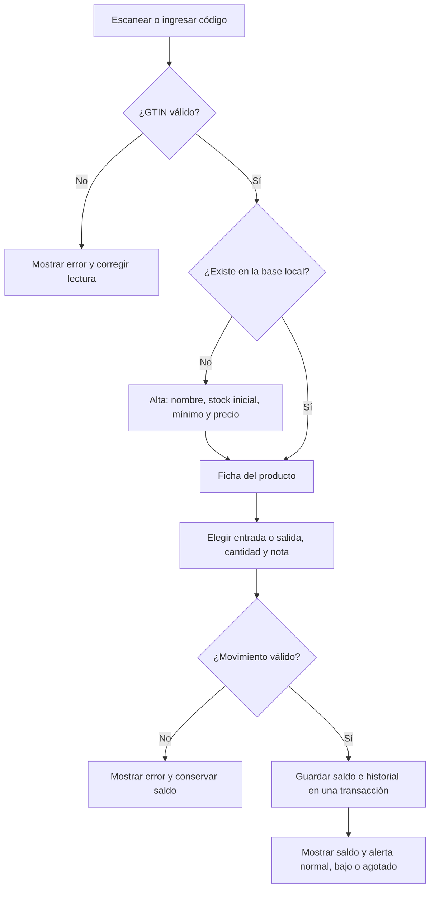

# Inventario de bodega con lectura de código de barras

**Tema 5 · Unidad 3 · Desarrollo de Aplicaciones Móviles y Web · UTEM 2026**

**Integrantes declarados en el proyecto:** Walter Olarte · Ulises Estepa · Camilo Arteaga

App Android/iOS para registrar recepción y despacho de productos desde un teléfono. Lee EAN-13, EAN-8 y UPC-A, permite crear productos desconocidos, conserva el inventario en SQLite y muestra alertas cuando el stock alcanza el mínimo. El ingreso manual permite trabajar sin permiso de cámara.

**Estado para empresas: piloto local de un solo dispositivo.** La aplicación todavía no debe ser el único registro de un inventario real: no incluye respaldo/restauración de la base, cuentas de operadores ni sincronización. La documentación describe la versión disponible y sus límites; no certifica una puesta en producción.

## Empezar según tu función

| Quién lo usa | Qué necesita | Guía |
| --- | --- | --- |
| Bodeguero u operador | App instalada y teléfono con cámara; no necesita Git, Node ni una cuenta Expo | [Manual de usuario](docs/MANUAL_USUARIO.md) |
| Encargado de la empresa | Definir dispositivo, responsables, conteo inicial, resguardo y prueba de aceptación | [Operación y entrega a una empresa](docs/OPERACION_EMPRESA.md) |
| Desarrollador o mantenedor | Código, Node/npm y Expo; firma y distribución para entregar la app | [Ejecución de desarrollo](#ejecutar-en-un-teléfono) y [compilación](#apk-para-prueba-física) |

## ¿Necesita internet siempre?

| Situación | Conectividad necesaria |
| --- | --- |
| App independiente instalada: escanear, alta, buscar, entrada/salida, alertas e historial | No. Las operaciones son locales. |
| Abrir de nuevo la app independiente con el computador apagado | No. El código se incluye en el binario instalado. Debe comprobarse en el teléfono de destino. |
| Expo Go: abrir desde el QR de `npx expo start` | El teléfono necesita llegar al servidor Metro del computador. La autenticación de Expo en iPhone requiere conexión al servicio. Es un entorno de desarrollo. |
| Usar `--tunnel` | Sí, teléfono y computador necesitan internet. |
| Instalar dependencias, iniciar sesión Expo, compilar en EAS o descargar un instalador | Sí, para esos servicios. |
| Generar Excel y guardarlo en el teléfono | La generación es local; depende de las opciones de guardado disponibles en el sistema. |
| Enviar Excel por correo o guardarlo en una nube | Depende de la aplicación elegida; normalmente necesita internet. |

**Trabajar sin internet no significa tener respaldo.** Un teléfono perdido o una instalación borrada puede dejarte sin el inventario. Tampoco hay actualización automática del stock en otros teléfonos.

## ¿Dónde está la base de datos?

- `App.tsx` abre **`bodega.db`** mediante `SQLiteProvider`. Al primer uso se crean tablas y, en aperturas posteriores, se usa la misma base y se aplican migraciones si corresponden.
- Vive en el **almacenamiento privado de la aplicación en ese teléfono**, dentro del directorio predeterminado de `expo-sqlite` (`defaultDatabaseDirectory`). La ruta absoluta depende del sistema y de la instalación; no es una carpeta del repositorio ni del computador.
- En Expo Go está dentro del entorno de Expo Go para ese proyecto; en una APK o app iOS independiente pertenece a esa instalación. **Pasar de Expo Go a una app instalada no migra los datos automáticamente.**
- `productos` conserva código, nombre, stock, mínimo, precio y fecha de alta; `movimientos` conserva entradas/salidas y ajustes, cantidades, precio histórico, motivo, fecha y saldos anterior/nuevo del ajuste. Las preferencias visuales se guardan aparte con AsyncStorage.
- Los datos **no se suben a GitHub, Expo ni a un servidor de la empresa** por las operaciones del inventario. Iniciar sesión con la misma cuenta en dos teléfonos no comparte sus bases.
- Cerrar la app o reiniciar el teléfono conserva los datos. Desinstalar, borrar datos de la app o usar **Vaciar toda la bodega** puede eliminarlos. No se garantiza recuperación mediante copias del sistema operativo.
- No hay exportación/importación de respaldo de SQLite desde la interfaz. Excel es un reporte y **no permite restaurar la base en esta versión**.

Referencia técnica: [SQLite en Expo](https://docs.expo.dev/versions/v58.0.0/sdk/sqlite/). Para diagnóstico, el mantenedor puede consultar `db.databasePath`; no debe copiar solo `bodega.db` mientras está abierto en WAL, porque podría omitir cambios del archivo de registro.

## Flujo de trabajo en la bodega



Escanear **solo abre la ficha o el alta**: no suma ni descuenta stock por sí mismo. El operador registra explícitamente el movimiento y revisa la confirmación. Un código válido no consulta catálogos externos ni rellena automáticamente el nombre o precio.

Para la primera puesta en marcha: contar físicamente, crear los productos con ese saldo inicial, revisar los resultados y comenzar los movimientos diarios. El alta ya registra el stock inicial como entrada; no volver a ingresarlo como otra recepción. El [manual](docs/MANUAL_USUARIO.md) detalla recepción, despacho, conteo, errores y cierre diario.

La base del fork procede de [waltZk8/utem-web-u3-t05-inventario-bodega](https://github.com/waltZk8/utem-web-u3-t05-inventario-bodega). Se conserva esa procedencia y se añaden correcciones y verificaciones. El equipo debe explicar qué partes desarrolló y cuáles adaptó.

> **Estado de entrega:** los requisitos funcionales de T05 están implementados y hay verificaciones automatizadas. Faltan evidencias en teléfono físico, resultados propios de medición, video y PDF final. La presentación contiene campos pendientes. Consulta [la revisión de la pauta](docs/REVISION_PAUTA.md).

## Ejecutar en un teléfono

Requisitos: Node.js 22.13 o superior (verificado con Node 24.20.0), npm, Git y Expo Go compatible con SDK 58. Android e iOS son los objetivos; la presentación HTML no es la app móvil.

```bash
git clone --branch revision-t05-pauta https://github.com/HectorEstepa/utem-web-u3-t05-inventario-bodega.git
cd utem-web-u3-t05-inventario-bodega
npm ci
npm run tipos
npm test
npx expo install --check
npx expo login
npx expo whoami
npx expo start --go
```

Estas instrucciones usan la rama de la revisión, mientras el PR #1 siga sin integrar a `main`. En Android, abre Expo Go y escanea el QR; en iOS, inicia sesión en Expo Go con la **misma cuenta** que muestra `whoami` y usa la cámara del sistema. El computador y el teléfono deben estar en una red que permita comunicarlos. Si la red los aísla, usa `npx expo start --go --tunnel` y acepta instalar la dependencia de túnel si Expo la solicita. La conexión carga el proyecto en desarrollo; las operaciones de inventario son locales.

Si ya clonaste esta rama, detén Metro con `Ctrl+C`, entra en tu carpeta del proyecto y actualiza con `git pull --ff-only`, `npm ci` y `npx expo start --go --clear`. Si Git informa cambios locales, consérvalos y revísalos antes de actualizar; no uses un reset para borrarlos.

Para comprobar persistencia sin Metro, usa un binario instalado. No borres datos de Expo Go ni desinstales la app durante la prueba: eso elimina su almacenamiento.

### Interpretar la terminal de Expo

| Mensaje | Qué significa y qué hacer |
| --- | --- |
| `Logged in` / `whoami` muestra tu usuario | La sesión del computador está iniciada; falta comprobar la sesión de Expo Go en el teléfono. |
| `Metro waiting on exp://...` y QR | El servidor está escuchando. Mantener la terminal abierta durante la prueba. |
| `iOS Bundled ...` | Se generó el código de iOS; no prueba por sí solo que cámara, base o interfaz funcionen. |
| `You're signed in to Expo CLI ... but not signed in to Expo Go` | Abrir el perfil de Expo Go en el iPhone e iniciar sesión con ese mismo usuario, luego volver a abrir el QR. |
| `The Internet connection appears to be offline` | Revisar conectividad/autenticación inicial de Expo, Wi-Fi y acceso al computador. Si la red local aísla equipos, usar túnel con internet. No demuestra un fallo de SQLite. |
| Aviso de `SafeAreaView` obsoleto | Actualizar esta rama y reinstalar dependencias; ahora usa `react-native-safe-area-context`. |
| Pide `react-dom` o `react-native-web` | Se intentó abrir la app como web. Esta versión solo tiene como destino Android/iOS: usar Expo Go, no `w`. La presentación `docs/index.html` sí se abre en navegador y es un recurso separado. |

Guía oficial para [sesiones de Expo Go en iPhone](https://docs.expo.dev/troubleshooting/expo-go-sign-in-required/).

## Demostración del tema 5

1. Abre **Escanear**: revisa la explicación y permite la cámara. Prueba también denegar y continuar con **Ingreso manual**.
2. Escanea un envase real con EAN-13, EAN-8 o UPC-A válido. Si no existe, aparece **Código nuevo detectado** y el formulario de alta.
3. Para probar manualmente, usa `4006381333931`, nombre «Artículo de prueba», stock `10`, mínimo `5` y precio `1290` CLP. El código no certifica el nombre del producto.
4. Registra entrada de `3`: saldo `13`. Registra salida de `8`: saldo `5` y alerta **STOCK BAJO**.
5. Intenta salida de `6`: se rechaza conservando saldo `5`. Despacha `5`: saldo `0` y estado **AGOTADO**.
6. Cierra completamente y reabre: verifica producto, saldo e historial. Repite en modo avión con el binario instalado.
7. En **Ajustes → Diagnóstico y benchmark**, ejecuta M1 y registra resultados y entorno en [el protocolo de pruebas](docs/PRUEBAS_DISPOSITIVO.md).

El catálogo demo agrega cinco artículos **ficticios**, con códigos de dígito verificador válido, precios CLP y movimientos sintéticos. No es un catálogo comercial certificado ni se inserta automáticamente.

## Qué implementa y dónde

| Requisito T05 | Implementación |
| --- | --- |
| Escaneo y permisos | `PantallaEscaner.tsx`: explicación, permiso, rechazo, Ajustes, alternativa manual y error de cámara |
| Código desconocido y alta | `App.tsx`, `PantallaAlta.tsx`: consulta local y código precargado |
| Entrada y salida | `src/db/inventario.ts`: saldo e historial en una transacción exclusiva |
| Persistencia | `src/db/schema.ts`: SQLite, WAL y migraciones atómicas |
| Stock bajo | `src/lib/stock.ts`, ficha y listado: estado derivado, texto, símbolo y color |
| Medición propia | `src/bench/medicion.ts` y diagnóstico; **resultados físicos pendientes** |

También hay búsqueda, filtros, historial, edición, temas visuales, dashboard y exportación Excel de cinco hojas por período. No hay servidor, cuentas ni sincronización entre teléfonos.

## Decisiones y límites

- **SQLite para inventario:** transacciones entre productos y movimientos y consultas por clave primaria. AsyncStorage guarda preferencias; M1 lo compara como arreglo JSON sin caché propia, no como todas las arquitecturas posibles con AsyncStorage.
- **Saldo y bitácora juntos:** se evita confirmar un saldo sin su movimiento. El estado de stock se deriva del saldo y el mínimo, sin guardar otra columna que pueda desactualizarse.
- **Montos enteros CLP:** el precio de cada movimiento se congela al registrarlo. Editar un precio no cambia movimientos anteriores.
- **Limitaciones:** sin respaldo automático, usuarios, facturación ni sincronización. Eliminar un producto elimina también su historial, previa confirmación; no es una bitácora contable inmutable. Excel exporta todos los movimientos del período elegido hasta 20.000; si se supera ese límite solicita acotar fechas, sin truncar filas. El historial se consulta por páginas de 50. No es un respaldo restaurable de la base.
- **Validación:** el bundle JS y las pruebas de escritorio no prueban cámara ni puente nativo de SQLite. Android e iOS necesitan validación física.

El catálogo demo anterior podía contener `7801610001625` y `7802900001015`, cuyos verificadores son incorrectos. Los nuevos ejemplos usan `7801610001622` y `7802900001018`. No se renombran registros existentes automáticamente: exporta y revisa tus datos antes de eliminar ejemplos antiguos.

## Períodos, historial y reportes

La versión 1.6.1 abre con **Este mes**. Antes de v1.4.0, las entradas y salidas eran acumulados de todo el historial. Dashboard ofrece una barra horizontal de períodos **Hoy, 7 días, 1M, 3M, 6M, 1A, Este mes, Este año, Todo y Elegir fechas**, con calendario nativo para inicio y fin. 1M son los últimos 30 días; 3M/6M/1A son ventanas móviles de meses, hasta hoy. Este mes/Este año incluyen el calendario completo. El rango aparece escrito en pantalla; ambos extremos incluyen días completos en la zona horaria del teléfono.

El mismo filtro de sesión se comparte entre Inicio, Dashboard, historial y exportaciones de Ajustes. Inicio muestra el período y lleva al Dashboard para cambiarlo. Al reiniciar el proceso se vuelve al mes actual. Los presets se recalculan al cambiar de día o volver a primer plano. **Stock, valorización actual, críticos y top de existencias siempre representan el estado actual**; no se reconstruye el stock de una fecha pasada.

Las entradas se identifican en verde y las salidas en violeta, sin significado de ganancia/pérdida. El rojo se reserva para errores, acciones destructivas y stock agotado. Los montos son unidades por precio registrado, no utilidades ni ventas cobradas.

El gráfico de evolución se adapta al ancho del teléfono: un selector **Entradas / Salidas** que muestra una sola línea a la vez: verde para entradas, violeta para salidas. Encima están los totales CLP y unidades con las fechas del período; cambian juntos al seleccionar otro rango. Tocar o deslizar muestra el intervalo y sus unidades; las flechas y la vista Tabla permiten consultarlas sin arrastrar. Cada punto suma actividad del intervalo, **no es stock histórico, acumulado ni rendimiento financiero**. Hasta 120 días agrupa por día; hasta ocho años, por mes; períodos mayores, por año. Los intervalos vacíos valen cero y los extremos parciales se identifican con fechas exactas. Los ajustes quedan fuera de ambas series. Se usa [react-native-svg compatible con Expo Go](https://docs.expo.dev/versions/v58.0.0/sdk/svg/).

**Corregir una entrada mal digitada:** ficha → Editar → Cantidad disponible corregida → elegir la recepción original (automática si hay una sola) → motivo → Guardar. Si se anotó 20 y eran 15, la entrada vigente pasa a 15 y el stock baja 5; las salidas no cambian. Si había despachos posteriores, se conserva su cantidad: con entrada 20, salida 5 y stock 15, rectificar la entrada a 15 deja stock 10. La vista previa identifica tanto la entrada rectificada como el saldo final. También permite aumentar una entrada subestimada o rectificarla a cero si el stock lo permite.

La cantidad original se conserva en SQLite. Se guarda una constancia `ADJ` vinculada al ID de entrada con cantidades anterior/nueva, saldos, motivo y fecha de rectificación. Inicio, Dashboard, gráficos y Excel usan la **cantidad vigente en la fecha original de recepción**, con su precio histórico; la constancia se consulta en la fecha de corrección. Los reportes de períodos pasados pueden cambiar tras rectificarlos: son reportes operativos actualizados, no cierres contables inmutables. Excel conserva cantidad original, ID y valores rectificados. Si la entrada cambió mientras se editaba o el saldo resultaría inválido, se rechaza todo sin cambios parciales.

Editar ofrece una sola corrección de cantidad: rectificar la recepción elegida. El selector de tipo «Corregir entrada / Ajuste de conteo» se retiró para evitar cambios de comportamiento mientras se edita. La entrada se mantiene seleccionada al borrar o cambiar el número; si hay varias, se elige en un modal con lista paginada. Cancelar restablece el formulario y no escribe datos. Los botones de recepción/despacho quedan bloqueados durante la edición. Guardar se habilita cuando la cantidad, entrada y motivo requeridos son válidos.

Los ajustes de conteo de versiones anteriores se conservan en la base, historial y reportes, pero esta pantalla ya no permite crear nuevos. Las salidas y ajustes existentes no se convierten automáticamente en rectificaciones. No hay identificación segura del operador ni bitácora inmutable.

**Historial** tiene acceso desde Inicio, Dashboard y la ficha. Incluye búsqueda por nombre/código/nota, filtro de tipo y período, fecha completa, ID de operación y carga de 50 en 50. La ficha conserva cinco movimientos recientes de todo el historial; su botón abre la consulta con el período compartido visible.

El Excel tiene estas hojas, con período, fecha de generación y zona horaria:

| Hoja | Contenido |
| --- | --- |
| Resumen | Entradas/salidas del período, fechas de primera/última operación y stock actual claramente separado |
| Inventario_actual | Catálogo y existencias al generar; no es un cierre histórico |
| Por_producto | Unidades y montos recibidos/despachados por producto en el rango |
| Por_dia_producto | Fecha local, producto y cantidades/montos de entrada y salida de cada día |
| Movimientos | Todas las operaciones del rango, ID, fecha y hora local, marca UTC, precio histórico y nota |

El archivo incorpora el rango en su nombre. Se exporta una instantánea consistente; las cinco hojas corresponden a la misma lectura de datos. Con más de 20.000 operaciones se pide elegir un período más corto. **No es un respaldo restaurable**. Cambiar fechas no modifica existencias ni elimina movimientos.

El calendario usa el componente [DateTimePicker compatible con Expo SDK 58](https://docs.expo.dev/versions/v58.0.0/sdk/date-time-picker/). Después de actualizar el código, ejecutar `npm ci` y reiniciar Metro. Una APK o compilación propia anterior debe reconstruirse para incluir esta dependencia nativa; una actualización de JavaScript por sí sola no la instala.

## Mediciones

| Medición | Alcance |
| --- | --- |
| M1 | 5.000 artículos sintéticos, 30 búsquedas por motor, con calentamiento. p50, p95 y peor tiempo en ms. Limpia datos temporales al finalizar. |
| M2 | Promedio de las últimas 30 consultas de la sesión, por cámara o ingreso manual. Excluye reconocimiento y renderizado. |
| M3 | Desde evaluación de `App.tsx` hasta primer efecto del contenedor. Excluye inicio nativo, evaluación de dependencias y carga completa de Inicio. |

No se incluyen resultados inventados. Registrar modelo, SO, versión de app, Expo Go/desarrollo o release, repeticiones, capturas y valores. Desarrollo puede alterar tiempos y su razón; preferir release y explicar el entorno.

## Verificaciones

```bash
npm run tipos
npm test
npx expo install --check
npx expo export --platform android --platform ios --output-dir dist
```

Las 27 pruebas cubren GTIN, CLP, stock y SQLite real de Node: persistencia, migraciones v1/v2/v3→v4, conservación de IDs/secuencia, rollback, ajustes sin alterar flujos, exportación de saldos, series con intervalos vacíos, ventanas de fechas, duplicados y datos inválidos. El adaptador no ejecuta Expo ni simula un teléfono. GitHub Actions repite estas verificaciones en push y pull request.

## APK para prueba física

Con cuenta Expo y EAS configurado para **su propio proyecto**:

```bash
npx eas-cli login
npx eas-cli whoami
npx eas-cli init
npx eas-cli build:configure
npx eas-cli build --platform android --profile preview
```

`preview` genera APK para instalación interna. La compilación se hace en EAS y puede estar sujeta a límites de la cuenta. **No se generó ni instaló un APK en esta revisión.** Para compilar Android localmente se necesita JDK/SDK compatibles con el proyecto generado por Expo; para iOS localmente, macOS y Xcode.

El mantenedor entrega el enlace/instalador y las instrucciones al operador. La empresa usuaria no necesita ejecutar comandos ni iniciar Metro. Para iOS, el instalador Android no sirve: debe prepararse distribución iOS firmada y gestionar los dispositivos o el canal de distribución correspondiente. Ver [compilación](https://docs.expo.dev/build/setup/) y [distribución interna de Expo](https://docs.expo.dev/build/internal-distribution/).

## Requisitos antes de una puesta en producción

La versión actual permite un piloto supervisado y contrastado con un registro de referencia. Para usarla como sistema principal hacen falta, como mínimo, **respaldo completo y restauración probada**, validación del dispositivo, gestión de acceso y actualizaciones controladas. Si varias personas operan desde distintos teléfonos, también hacen falta backend, autenticación, sincronización y resolución de conflictos; instalar la app en varios equipos no implementa nada de eso.

El [plan de operación](docs/OPERACION_EMPRESA.md) distingue capacidades actuales, tareas de entrega y funciones pendientes. Incluye continuidad ante pérdida del equipo, mantenimiento, responsabilidades y criterios de aceptación. No se presenta el proyecto como listo para producción por haber escrito un manual.

## Entrega académica

- [Revisión de la pauta y pendientes](docs/REVISION_PAUTA.md).
- [Pruebas físicas y registro de mediciones](docs/PRUEBAS_DISPOSITIVO.md).
- [Guía del informe, declaración de IA y bibliografía](docs/GUIA_INFORME.md).
- [Presentación existente](docs/index.html): abrir en navegador y completar pendientes antes de grabar.

Según la pauta facilitada: **un solo PDF**, siete secciones y máximo cinco páginas de desarrollo. Video de 5 a 10 minutos, presentación y repositorio enlazados en portada. Faltan RUT, firmas y enlaces finales; completar esos datos privadamente en la entrega al docente.
